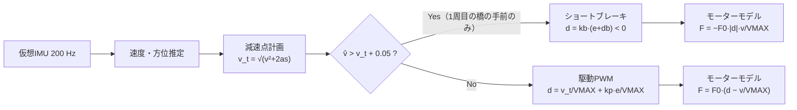

# ミニ四駆 ラップタイム最適化レポート（ショートブレーキあり）

- 前回レポート: `ラップタイム最適化レポート.md`（ブレーキなし。モーターは惰性でしか減速できない前提）
- 今回の条件: モーターの **ショートブレーキ**（モーター端子を短絡して減速する）を使える
- 走行動画: `UE走行動画_ラップタイム最適化_ショートブレーキ.mp4`（リポジトリ直下）（前半は実時間、後半は ×0.5 のスロー）
- 作成日: 2026-10-30

---

## 1. 結論

| | ブレーキなし（前回の最終設定） | **ショートブレーキあり（今回の最終設定）** |
|---|---|---|
| 3周タイム（平均） | 4.047 s（11試行） | **3.925 s（30試行）** |
| 最速 | 3.981 s | **3.876 s** |
| 完走率 | 11/11 | 30/32（94 %） |
| ばらつき（標準偏差） | 0.091 s | **0.023 s** |
| 動画の走行（初期位置のずれなし） | – | 3.946 s |

数値の補足:

- ブレーキなしの欄は、今回と同じ UE セッションで基準として測り直した値です。
- ブレーキありの欄は、同じ設定で回した3回のバッチ（b25・b26・b27）を合わせた集計です。
- ショートブレーキを掛けていた時間は、1回の走行あたり実効で約 0.05 s です。

**3周の平均タイムは約 0.12 s（約3 %）短縮しました。** 実機の通常モーター（3周で約 5.7 s）と比べると **約 −31 %** です。

ラップごとの平均は次のとおりです。

| | 1周目 | 2周目 | 3周目 |
|---|---|---|---|
| ブレーキなし | 1.752 s | 0.888 s | 1.407 s |
| ショートブレーキあり | **1.653 s** | 0.888 s | **1.384 s** |
| 差 | **−0.10 s** | ±0 | −0.02 s |

短縮はほぼ1周目の橋の手前で得られています。2周目と3周目の制御はブレーキなしの場合と同じです。

---

## 2. 各パラメータの値

### 2.1 車体（前回と同じ）

| パラメータ | 値 | 根拠 |
|---|---|---|
| 車体重量 | 90 g | タミヤ公式レギュレーションの最低重量 |
| 最高速度 VMAX | 8.8 m/s | マッハダッシュPRO、ギヤ比 3.5:1、タイヤ径 24 mm |
| 最大駆動力 F0 | 1.302 N | F0 = MOTOR_K / VMAX |

### 2.2 モーターモデル（ショートブレーキを追加）

| 状態 | 力 |
|---|---|
| 駆動（デューティ d > 0） | F = F0 · max(0, d − v/VMAX) |
| **ショートブレーキ（d < 0）** | **F = −F0 · \|d\| · v / VMAX**（制動力は速度に比例） |
| 惰性（d = 0） | a = −0.25 · v |
| 上限 | \|a\| ≤ μg（μ = 1.0、4輪駆動なので制動も4輪にかかる） |

ショートブレーキは、端子を短絡したときに逆起電力（速度に比例）で流れる電流が制動力になる、という原理をそのままモデル化しています。そのため低速ほど効きが弱くなります。

### 2.3 制御パラメータ（最終設定）

| 名前 | 値 | 意味 | 前回から |
|---|---|---|---|
| `brake` | 1 | ショートブレーキを使う | 新規 |
| `brake_n` | 0 | ブレーキは1回目のレーンチェンジ（1周目の橋）の手前だけで使う | 新規 |
| `brake_bridge` | 0 | 坂の上と橋の上ではブレーキを使わない | 新規 |
| `kb` | 2.5 /(m/s) | ブレーキのデューティ = kb ×（速度超過 − 不感帯） | 新規 |
| `brake_db` | 0.05 m/s | 不感帯。目標をこれ以上超えたときだけブレーキを掛ける | 新規 |
| `v_over_first` | 2.9 m/s | 1周目の坂の手前の目標速度 | 新規（前回は 2.7） |
| `a_coast` | 10.0 m/s² | 1周目の減速開始点を決めるときの想定減速度（ブレーキ前提） | 4.5 → 10.0 |
| `v_over` | 2.7 m/s | 3周目の坂の手前の目標速度 | 同じ |
| `a_coast_late` | 5.0 m/s² | 3周目の想定減速度（惰性） | 同じ |
| `v_bridge` / `kp_bridge` | 2.8 m/s / 8.0 | 橋の上での速度保持 | 同じ |
| `kp` | 4.0 | 通常区間の速度ループゲイン | 同じ |
| `r_eff` / `l_str` / `phi_post` | 0.37 m / 0.93 m / 35° | コースの幾何 | 同じ |
| `est` | 0 | 速度推定器（前回と同じ航法座標系での積分） | 新規パラメータ |

---

## 3. 制御手法

### 3.1 ブレーキ則

    e = v_t − v̂
    e < −brake_db のとき:  d = max(−1, kb · (e + brake_db))   … ショートブレーキ
    それ以外:              d = v_t/VMAX + kp · e / VMAX（0〜1 にクリップ）

目標速度 v_t の決め方は前回と同じです。橋までの残り距離 s から v_t = √(v_over² + 2·a·s) で求めます。ブレーキを前提にすると想定減速度 a を大きく取れるので、全開で走れる距離が伸びます。

### 3.2 ブレーキを1周目に限定した理由

| 周 | IMU 速度推定の誤差（橋の手前） | ブレーキの効果 |
|---|---|---|
| 1周目 | ±0.08 m/s 程度（低速で、壁への衝突が軽い） | 減速点を遅らせられ、1周目が 0.10 s 短縮 |
| 3周目 | −0.3〜−0.7 m/s（時速20 km 超で壁に衝突した後） | 「まだ遅い」と誤判定し、速すぎる速度で橋に入ってコースアウト |

3周目に橋へ入る直前の壁への衝突では、加速度がセンサのレンジ（±16 g）を超えて頭打ちになります。さらに、ジャイロで求めた向きと速度ベクトルの向きが数度ずれ、約 4 g の向心加速度が速度に漏れ込みます。この2つが推定誤差の原因でした（4.2 節を参照）。推定が信用できない場面で強いブレーキを掛けると、かえって危険です。そのため、推定が正確な1周目に限ってブレーキを使います。

### 3.3 坂の上・橋の上でブレーキを使わない理由

橋の上でもブレーキで 2.8 m/s を保つと、下り坂で自然に加速できません。出口のS字に遅すぎる速度で入るため、1周目の終盤と2周目でコースアウトが増えました（b23: 8試行中1〜5回完走）。`brake_bridge = 0` にすると改善しました。

### 3.4 目標速度を 2.9 m/s にした理由

ブレーキで目標速度に合わせ込むと、0.15〜0.2 m/s ほど行き過ぎ（アンダーシュート）が出ます。目標が 2.7〜2.8 m/s のままだと、坂の手前の実速度が約 2.60 m/s まで下がり、壁への着地で失敗しました。目標を 2.9 m/s に上げると、実際の進入速度が 2.69〜3.03 m/s に収まり、完走率が上がりました。

---

## 4. システム構成

### 4.1 変更点

| ファイル | 変更内容 |
|---|---|
| `ue/m4wd_drive.py` | ショートブレーキの力モデル、ブレーキ時間の記録、HUD とリプレイへのブレーキ状態表示 |
| `ue/m4wd_ctrl.py` | ブレーキ則と関連パラメータ（`brake`、`kb`、`brake_db`、`brake_n`、`brake_bridge`、`brake_str`、`v_over_first`、`est`）、推定器の候補（EstimatorMid、Map、Level、Align、Hybrid、Fwd） |
| `opt/q_b21.json` 〜 `q_b27.json` | 今回の試行バッチ |
| `opt/q_video_fb*.json` | 動画用のリプレイ設定 |

### 4.2 推定器の比較（オフライン検証）

前回の走行ログ（2.08 ms 刻みの姿勢と位置）から仮想 IMU の値を再生成し、推定器ごとの速度誤差（RMS）を比べました。

| 推定器 | 誤差 RMS（基準走行） | 結果 |
|---|---|---|
| 航法座標系で積分（従来） | 0.285 m/s | 採用（UE 上で最も安定） |
| 区間の中央の姿勢で変換 | 0.197 m/s | 走行によっては悪化。UE 上でも不安定 |
| 平坦区間で傾きをリセット | 0.177 m/s | 3周目の誤差は残る |
| 前方向だけを積分 | 0.334 m/s | ジャンプと着地で誤差が大きい |
| 速度ベクトルを前方向へ射影 | 0.410 m/s | 射影のたびに速度を失う |
| 速度ベクトルを前方向へ回転 | 0.241 m/s | 向心加速度で速度を過大評価 |

センサのレンジを超える壁への衝突がある以上、IMU だけで ±0.1 m/s の精度を保つのは難しい、と判断しました。

### 4.3 評価条件

- 物理ステップは time dilation 0.25 で 2.08 ms（前回と同じ）。
- 各設定を初期位置・向きを揺らした 8〜16 条件で評価しました（dy ±0.15 cm、dyaw ±0.3° まで）。
- **重要な発見**: 同じ設定・同じ刻みでも、UE を再起動すると結果が変わります。前回「15/15 完走」だったブレーキなしの設定も、今回のセッションでは 3 試行すべてコースアウトしたバッチ（b21）がありました。Chaos 物理は実行ごとに完全には一致しません。そのため今回は、1条件 3 試行ではなく 8〜16 試行で完走率を評価しました。

---

## 5. 最適化の経緯（ショートブレーキ編）

| バッチ | 内容 | 結果 |
|---|---|---|
| b21 | 全周でブレーキ（初期のブレーキ則） | 0/15。ブレーキがほとんど掛からず、3周目でコースアウト |
| b22 | ブレーキ則を修正、推定器を比較 | 最速 3.92 s だが 3 試行中 1〜2 回の完走 |
| b23 | 1周目だけブレーキ（橋の上でも使用） | 1/8〜5/8。橋を降りた後に失敗 |
| b24 | 橋の上ではブレーキを使わない | 最大 7/8、平均 4.007 s |
| **b25** | **目標 2.9 m/s、kb 2.5** | **8/8、平均 3.935 s** |
| b26 | 追試と、さらに攻めた設定 | 追試 7/8（3.907 s）。3周目の直線でもブレーキを使う案は 7/8（3.910 s）、もっと攻めた案は 1/8 |
| b27 | 最終検証（16 条件） | 15/16、平均 3.929 s |

**打ち切った理由**: 3周目にもブレーキを使う案は、推定誤差のため短縮がほぼゼロか、完走率が大きく下がりました（1/8）。1周目はすでに橋の進入速度の安全幅の上限付近まで詰めています。これ以上縮めるには、速度推定の精度を上げる必要があります。

---

## 6. 制約の確認

| 制約 | 対応 |
|---|---|
| コースアウトせずに3周完走 | 最終設定で 30/32 試行が完走（失敗2回は初期位置を大きくずらした条件と3周目） |
| 走行方法は前回の動画どおり | 同じコース、同じスタート位置（内側レーン）、右回り |
| 地球上で走行 | g = 9.80665 m/s²、μ = 1.0 |
| 速度は IMU で制御 | 推定と制御は IMU の値（200 Hz）だけ。ブレーキの指令も IMU の推定速度から決める |

---

## 7. 限界と次の一手

1. **完走率は 100 % ではありません。** 物理エンジンの非決定性と着地のばらつきから、約 6 % の失敗が残ります。
2. **3周目の推定誤差。** 次の対策が候補です。
   - モーターの逆起電力から車輪速を測る。PWM がオフの間に端子電圧を読むだけで、追加部品は抵抗分圧と ADC です。
   - IMU のレンジを ±16 g より広げるか、高い周波数（1 kHz 以上）でサンプリングする。
3. **逆転ブレーキ（プラギング）。** 低速でもグリップ限界まで減速できます。行き過ぎ（アンダーシュート）を抑えられる見込みがあります。
4. **シミュレーションの改良。** 壁への衝突が硬い（衝撃が大きい）こと、タイヤ横力が時間刻みに依存することは、前回から課題のままです。
